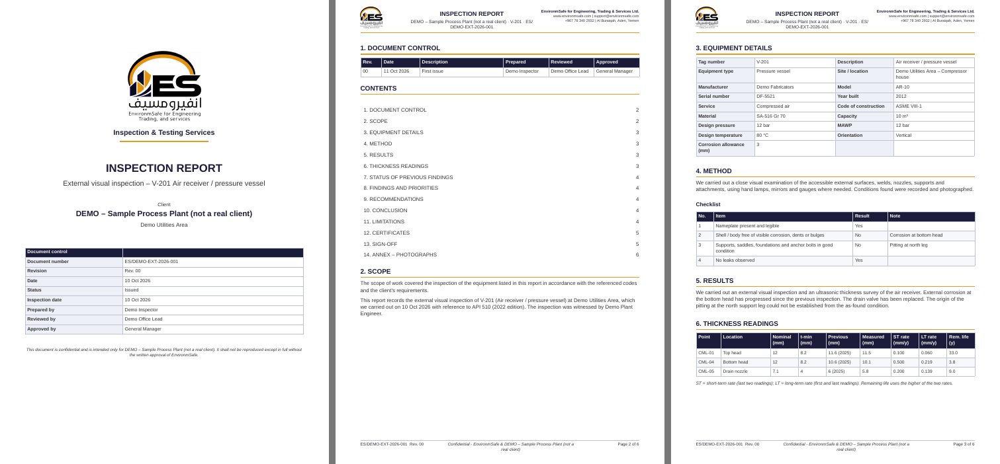
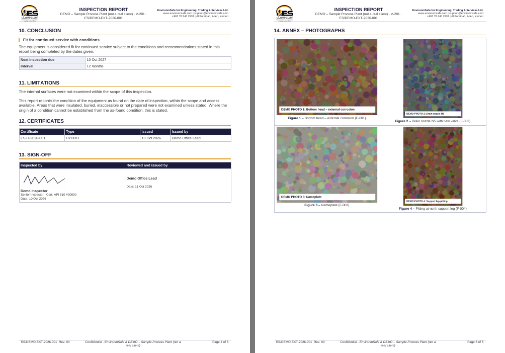
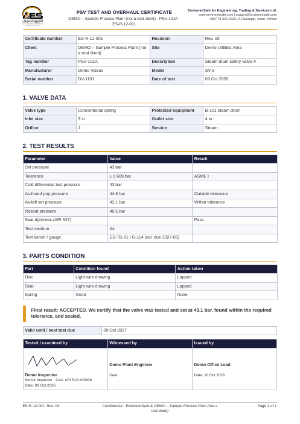
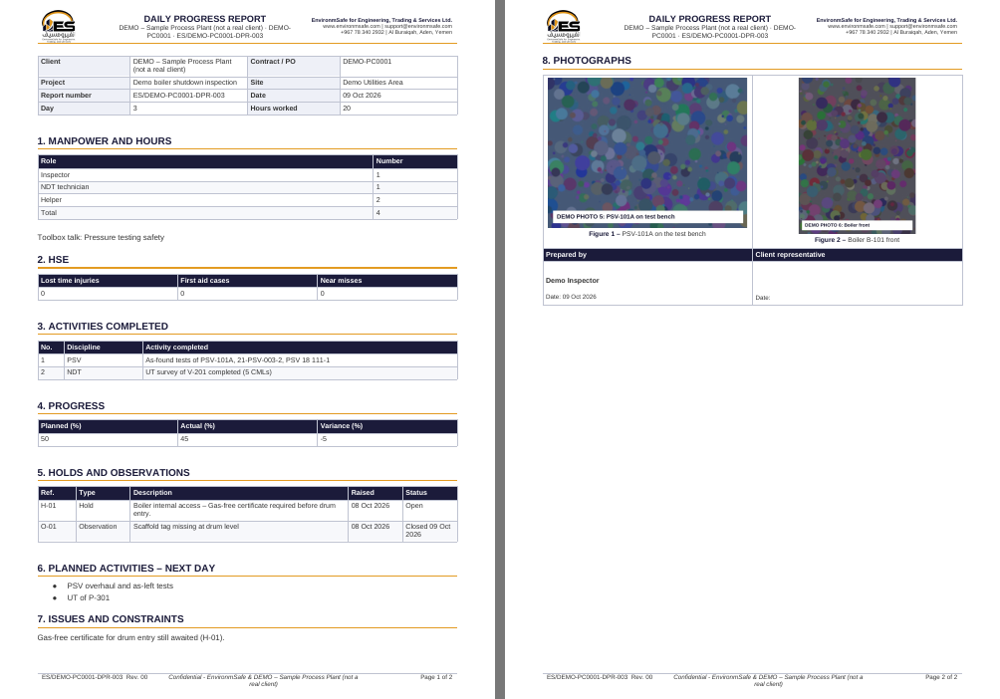

# Test report

Last full run: 2026-10-11, in the build container. Detailed iteration history: [test-log.md](test-log.md).

## Summary

| Suite (section 13 of the brief) | Tests | Last result | Fix iterations |
|---|---|---|---|
| 1. Unit tests – corrosion rate, remaining life, half-life interval, due dates and buckets, unit conversion (bar / kg/cm² / psi / MPa), PSV tolerance (ASME VIII, ASME I), tag normalisation and near-duplicates, numbering, revision labels | 19 | **19 pass** | 1 (passed first time) |
| 2. Database – migrations from empty (twice, to prove re-runnable) and Row Level Security with six simulated users (Admin with and without two-step, Office, Inspector ×2, Viewer, client-restricted Viewer) plus anonymous and unknown users | 65 | **65 pass** | 2 (one real bug: revoked sessions could still read data) |
| 3. Browser end-to-end, desktop 1280×860 **and** phone (Pixel 7): client, site, asset with free-text tag and near-duplicate warning, child PSV, inspection with checklist, UT readings, photo, finding, signature and issue, **second inspection a year later with carry-over** (submission blocked until done), inspection report Word + PDF, certificate issued with number, job with hold, one-tap DPR Word + PDF, final report, custom report, due board + export, Excel import (assets, previous findings), search in any tag format, user creation, export-everything ZIP | 28 | **28 pass** | 14 runs (seven real bugs fixed, listed below) |
| 4. Offline simulation: network off, inspection with photo, app closed and reopened offline, network on, everything synced, deliberate conflict resolved and listed for Admin | 2 | **2 pass** | 2 |
| 5. Generated documents: 6 types rendered to Word and PDF, opened, rendered to page images and checked visually for header, footer, page X of Y, tables, photo annex, signatures, page breaks | 6 | **6 pass** | 5 visual rounds (clipped images in Word, wrapping header, footer sizes, orphaned headings, blank pages) |
| 7. Security: no access without login, no file access without a signed link, viewer cannot write, inspector cannot escalate role or sign others out, audit log unreadable, script in a field shown as text and not run, secrets scan of repository and built app, `npm audit` | 10 + scans | **pass**, 0 vulnerabilities | 1 |
| 8. Lighthouse (mobile, simulated slow 4G) on the sign-in page | – | Performance **96**, Accessibility **100**, Best practices **100** | 2 (logo image made 20× smaller) |
| 9. Backup + restore into a fresh empty database, row counts compared for every table | 1 | **pass** (all 28 tables identical) | 2 |

Real bugs found and fixed by the tests: (1) signed-out sessions could still read; (2) rows created on a phone lacked default values (screen crashed); (3) a missing local index broke report generation; (4) a queued change could be sent before a record it depended on; (5) changes in transit when the app closed were never retried; (6) network calls without a time limit could stall syncing; (7) an edit made on the phone before its record reached the server was rejected as older (the signature was lost); (8) two quick taps could overwrite each other's checklist / carry-over answers.

## Not yet run (waiting for accounts)

| Item | Why not yet | What will run |
|---|---|---|
| 6. Android on an emulator or phone | The Android build tools are blocked in this container; the APK is built by GitHub Actions on the first release | Release workflow builds and signs the APK and verifies the signature. **No emulator run**: GitHub's free runners cannot run an Android emulator reliably. The same web code is fully tested in a phone-size browser above. Please do the 5-minute phone check in the final message. |
| E2E against a real Supabase stack | Runs in GitHub Actions (`Tests` workflow, job `e2e-supabase`) once the private repository exists | Same 40 browser tests against real Supabase Auth (with two-step sign-in), Storage and the Edge Function |
| 9. Keep-alive and nightly backup on the live project | No live project yet | Both workflows, then a manual run of each |
| 10. Production smoke test | No live site yet | `tests/smoke` after every release: headers, HTTPS, APK checksum = version.json, anonymous access refused, sign-up refused, optional Admin sign-in |

## Screenshots

Phone: [home](screenshots/phone/01-home.png) · [asset](screenshots/phone/02-asset.png) · [thickness trend](screenshots/phone/03-thickness-trend.png) · [checklist](screenshots/phone/05-checklist.png) · [previous findings](screenshots/phone/06-previous-findings.png) · [due board](screenshots/phone/10-due-board.png) · [sync](screenshots/phone/12-sync.png)
Desktop: [home](screenshots/desktop/01-home.png) · [asset](screenshots/desktop/02-asset.png) · [job](screenshots/desktop/09-job.png) · [findings](screenshots/desktop/11-findings.png)

Generated documents (sample files in [samples/](samples/)):

