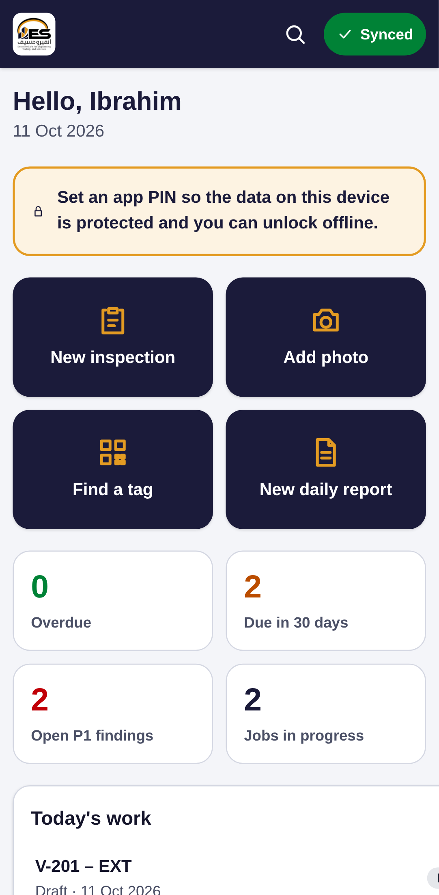
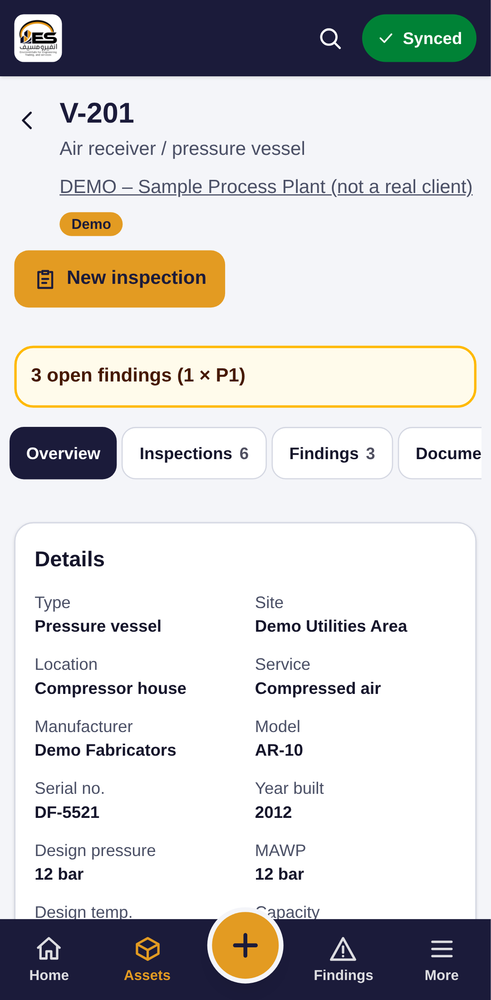
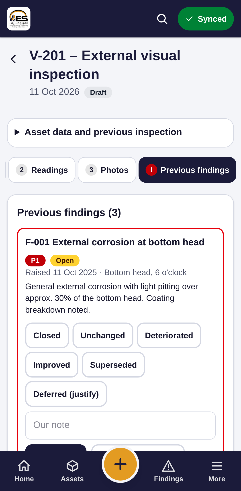

# EnvironmSafe Records – User Guide (inspectors)

## 1. Sign in and protect the phone
1. Open the app (or the website) and sign in with your e-mail and password. The first time, choose your own password.
2. On the Home screen tap the yellow box **Set an app PIN**. With a PIN you can unlock the app without internet.
3. The bar at the top right shows the sync state: **green = synced**, **yellow = offline or waiting**, **red = needs attention** (tap it).

## 2. Find an item
- Tap **Find a tag** and point the camera at the QR label, or type part of the tag (e.g. `201` finds `PSV-201A`).
- Or tap **Assets** at the bottom and type in the search box.

The asset page shows its details, open findings, inspections, documents, photos and readings.

## 3. Do an inspection (works with no internet)
1. On the asset tap **New inspection**, choose the type, check the date, tap **Start inspection**.
2. Work through the steps at the top:
   - **Checklist** – Yes / No / N.A.; a "No" asks for a note.
   - **Readings** – type the measured thickness for each point. The corrosion rate and remaining life appear at once. PSV and pressure tests have their own forms.
   - **Photos** – **Take photo** or **From gallery**. Add a caption to each; it becomes the figure caption in the report.
   - **Previous findings** – every open finding from earlier inspections. Choose Closed / Unchanged / Deteriorated / Improved / Superseded / Deferred for **each one** and add a note (Deferred needs a reason). You cannot submit until all are done.
   - **New findings** – **Add finding**: what, where, severity, priority (P1 = within 6 months, P2 = next shutdown, P3 = routine), recommendation. Add photos to it.
   - **Conclusion & sign** – conclusion, summary (write "we found…", state facts), next due date (proposed for you), then **Draw signature** and **Submit**.

Everything is saved as you type. Nothing is lost if the app closes.

## 4. Daily progress report
Open the job → **New daily report**. It starts from yesterday's planned activities, manpower and progress. Add today's activities, HSE numbers, photos and tomorrow's plan, then tap **PDF + Word**.

## 5. Photos and documents at any time
- **+ → Add photo**: pick the tag, take the photo.
- On an asset → **Documents → Upload** for manuals, drawings, data sheets and old reports.

## 6. When there is no internet
Keep working. The yellow bar shows how many changes are waiting. They are sent automatically when the phone is online again. **Do not sign out while changes are waiting** – the app will warn you.

If the sync bar turns red, tap it: the list shows which change the server refused and why. Usually the office needs to fix something (e.g. the record was already issued).

## 7. Help
Menu **More → Help**, or call the office: +967 78 340 2932, support@environmsafe.com.
